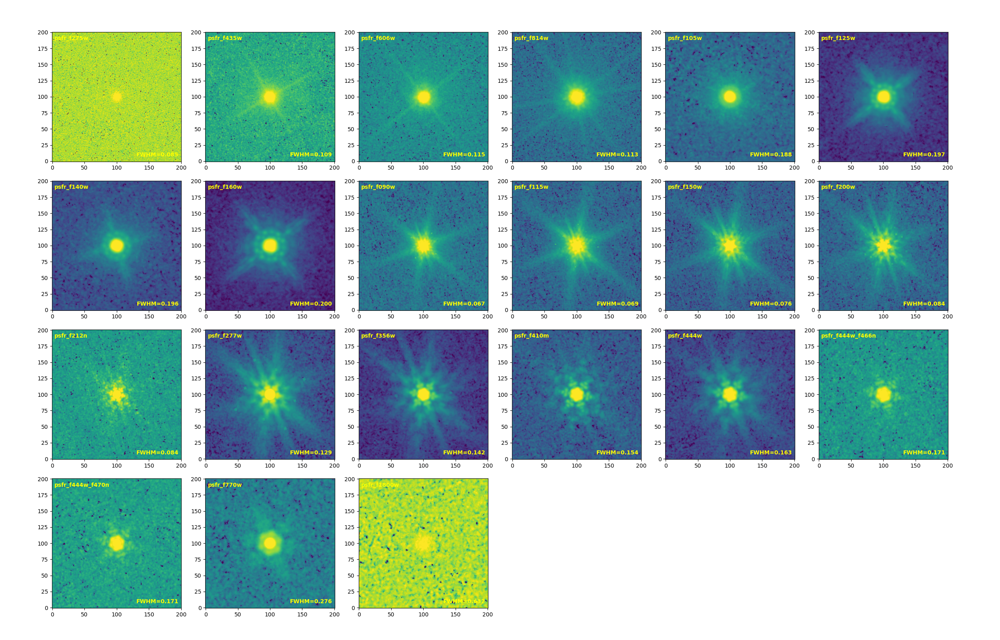

# COSMOS PSF

<a class="detail-back-link" href="../index.html#point-spread-functions-psfs"><svg viewBox="0 0 24 24" aria-hidden="true"><path d="m14 5-7 7 7 7"></path><path d="M7 12h12"></path></svg>Back to Point-Spread Functions</a>

  

    <strong>COSMOS PSF downloads</strong>
    
Downloads are currently restricted to approved JWST-SPRING team members.

  

  

    <svg viewBox="0 0 24 24" aria-hidden="true"><rect x="5" y="10" width="14" height="11" rx="2"></rect><path d="M8 10V7a4 4 0 0 1 8 0v3"></path></svg>Private team only
    <a class="team-access-button" data-team-field="cosmos" href="https://jwst-spring-team.jwst-spring-team-access.workers.dev/team/psf/cosmos/">Private PSF downloads →</a>
  

## Stacked PSF

### HST

|     Band      | F606W | F814W |
|:-------------:|:-----:|:-----:|
| FWHM (arcsec) | 0.115 | 0.113 |

### NIRCam

|     Band      | F090W | F115W | F150W  | F200W | F212N | F277W | F356W | F410M | F444W | F444W_F466N | F444W_F470N |
|:-------------:|:-----:|:-----:|:------:|:-----:|:-----:|:-----:|:-----:|:-----:|:-----:|:-----------:|:-----------:|
| FWHM (arcsec) | 0.067 | 0.069 | 0.076  | 0.084 | 0.084 | 0.129 | 0.142 | 0.154 | 0.163 |    0.171    |    0.171    |

### MIRI

|     Band      | F770W | F1800W |
|:-------------:|:-----:|:------:|
| FWHM (arcsec) | 0.276 | 0.632  |
